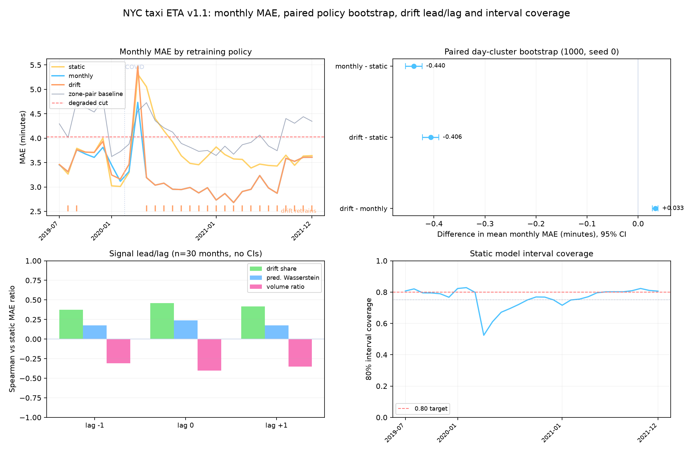

# NYC Taxi Trip-Time Service

[](https://github.com/Creator101-commits/nyc-taxi-eta-service/actions/workflows/ci.yml)

A reproducible study of NYC yellow-taxi trip times: a LightGBM ETA model,
label-free drift alarms, retraining-policy simulation with a paired
bootstrap, a FastAPI service and a dark single-page map website.

The question: **do label-free drift alarms on a deployed trip-time model
predict the months when its error rises, and does drift-triggered
retraining beat a static model and a fixed monthly schedule?**

## Contents

- [Features](#features)
- [Quickstart](#quickstart)
- [Installation](#installation)
- [API endpoints](#api-endpoints)
- [Website](#website)
- [Architecture](#architecture)
- [Methodology](#methodology)
- [Results](#results)
- [Findings](#findings)
- [Reproduction](#reproduction)
- [Development and testing](#development-and-testing)
- [Limitations](#limitations)
- [Reproducing the figure](#reproducing-the-figure)
- [License](#license)

## Features

- Frozen `nyc-taxi-eta-v1` protocol: TLC monthly Parquet data, four
  cleaning filters with per-filter counts, per-month seeded uniform
  sampling (200,000 rows/month), request-time-only features, a frozen
  LightGBM grid selected on validation MAE only, split-conformal 80%
  intervals, label-free drift signals and three retraining policies.
- Deployment simulation over 30 months (2019-07 to 2021-12) with
  per-month MAE, coverage, borough slices, a train-only zone-pair
  baseline and drift alarm/precision-recall accounting.
- Paired day-cluster bootstrap (1,000 replicates, seed 0) comparing the
  three policies on identical resamples, plus per-month static CIs.
- Lead/lag Spearman analysis of each drift signal against the static
  MAE ratio, and a labeled post-hoc two-sided volume sensitivity.
- FastAPI prediction service with model metadata and an 80% interval;
  Docker image serving API plus the built website on one port.
- Single-page website: dark MapLibre map, animated taxis on
  **illustrative** routes, deployment-drift chart, demo-day selector
  with volume-proportional taxi counts, live prediction card.

## Quickstart

```bash
uv sync
uv run nyc-eta serve --host 0.0.0.0 --port 8000   # needs results/model_bundle + web/dist
```

The API answers `POST /predict` and serves the built site at `/`.
Without `web/dist` or the bundle, set `NYC_ETA_WEB` / `NYC_ETA_BUNDLE`
or build them first (see Installation).

## Installation

```bash
git clone https://github.com/Creator101-commits/nyc-taxi-eta-service.git && cd nyc-taxi-eta-service
uv sync                      # Python 3.12-3.13
cd web && npm ci && npm run build && cd ..
```

The served model bundle is committed under `results/model_bundle/`
(LightGBM `model.txt`, zone lookup, zone shapefile, distance table).
`NYC_ETA_BUNDLE` overrides the default `results/model_bundle` path;
tests build a tiny fixture bundle in a tmp dir instead.

## API endpoints

- `GET /health` -> service status, model version, trained-through month,
  zone count.
- `GET /ready` -> readiness probe.
- `GET /zones` -> all 265 zone records (id, name, borough, lat, lon).
- `GET /model-info` -> training window, validation metrics, git sha.
- `POST /predict` with `{pickup_zone_id, dropoff_zone_id,
  pickup_datetime}` -> `{minutes, interval_80: {low, high},
  model_version, route}`. Zone IDs outside 1..263 (422), unknown zones
  and malformed datetimes are rejected; post-trip fields cannot be
  supplied. `route` is reserved and currently null: the service scores
  zone-centroid features and does not compute turn-by-turn geometry.

## Website

`web/` is a Vite + TypeScript single page: a dark MapLibre map with taxi
zone polygons, animated taxis moving along **illustrative** routes (the
OSM drive-graph shortest paths between zone centroids; TLC data has
zones and timestamps, not GPS traces), a deployment-drift chart and a
live prediction card backed by `/predict` when the API is running.

- The replay compresses a demo day into a two-minute loop with a
  time-of-day clock, play/pause control, and honors
  `prefers-reduced-motion` (starts paused on a static frame). Hovering a
  taxi shows actual vs predicted minutes.
- Demo days are volume-proportional: 2019-10-01 shows 4,000 taxis for
  about 202,847 real cleaned trips and 2020-04-07 shows 151 taxis for
  about 7,661 real trips; on both days **1 taxi = about 51 real
  trips**.
- A successful prediction highlights the two zones with a dashed
  straight-line connector labeled "straight-line connector, not a
  route"; road geometry appears only on the replay trips. When the API
  is unreachable (static hosting) the card says so explicitly.

The served model is trained on 2021-10..2021-12, so predictions reflect
late-2021 traffic patterns.

## Architecture

- `src/nyc_eta/` - package: `data` (TLC downloads/cleaning/sampling),
  `zones` (lookup + shapefile + GeoJSON), `features`, `routing` (OSMnx),
  `models` (baseline + LightGBM), `conformal`, `metrics`, `drift`,
  `policies`, `tracking` (MLflow), `service` (FastAPI), `experiments`
  (protocol orchestration), `cli`.
- `kaggle/`, `kaggle_smoke/`, `kaggle_graph/` - kernel entrypoints and
  metadata.
- `scripts/` - `kaggle_run.sh`, `build_graph_dataset.sh`,
  `make_fixture_bundle.py`, `render_figure.py` + `figure-data.json`.
- `web/` - Vite + TypeScript site; `web/public/data/` holds the v1.1
  export copied unedited from kernel output.
- `results/` - unedited kernel output plus `v1_as_run/` (the earlier
  as-run manifest).
- `tests/` - fixture-only unit tests; no downloads.

All data processing, training and drift computation runs in private
CPU Kaggle kernels; nothing heavy runs on the laptop. Local work is
fixture-based unit tests, the web build and lint.

## Methodology

Protocol `nyc-taxi-eta-v1`, frozen in `src/nyc_eta/config.py`:

- **Period:** 2019-01 through 2021-12, including the COVID shock. The
  window was chosen with hindsight to include COVID; this is disclosed
  here and in PLAN.md.
- **Splits:** train 2019-01..04, validation 2019-05..06, deployment
  simulation 2019-07..2021-12 (30 months). A final served model trains
  on 2021-10..2021-12.
- **Data:** TLC yellow-taxi monthly Parquet files from the public
  cloudfront bucket, plus `taxi_zone_lookup.csv` and `taxi_zones.zip`.
  Every downloaded file records URL, sha256, size and Last-Modified in
  the run manifest.
- **Cleaning (identical every month, counts after each filter
  recorded):** 1. pickup timestamp inside the file's month; 2. duration
  in [1, 180] minutes; 3. pickup and dropoff zone IDs in 1..263 (264/265
  dropped); 4. dropoff not before pickup.
- **Sampling:** uniform per month with a fixed per-month seed; 200,000
  cleaned trips per month.
- **Features (request-time only):** pickup/dropoff zone and borough,
  same-zone flag, airport flags (JFK 132, LGA 138, EWR 1), haversine
  distance, road distance between zone centroids from OSMnx shortest
  paths on the NYC drive graph (263x263 directed pairs), pickup hour,
  day of week, US federal holiday flag. Post-trip fields (`trip_distance`,
  fares, tips, dropoff time, payment type, ...) are in
  `FORBIDDEN_FEATURES` and rejected by `assert_no_leakage`.
- **Baseline:** median minutes by zone pair, falling back to borough
  pair, then global median; trained once on the training window and
  never refit.
- **Main model:** LightGBM predicting `log1p(minutes)`. Frozen grid:
  `num_leaves` in {63, 255} x `min_data_in_leaf` in {50, 500}, learning
  rate 0.05, early stopping 100 rounds on validation minutes-MAE, max
  3000 rounds. Selection uses validation only; every config records
  `best_iteration` and `cap_bound`.
- **Conformal:** split-conformal 80% interval on the log1p scale from
  validation residuals.
- **Drift signals (label-free):** Evidently `DataDriftPreset`
  drifted-feature share, prediction-distribution Wasserstein distance,
  trip-volume ratio (month cleaned-trip count over the mean monthly
  train cleaned count, so real demand drops register). Each signal's
  alarm threshold is the maximum over the two validation months
  (pre-specified). A month is degraded when its MAE exceeds validation
  MAE by more than 10%.
- **Policies:** static model; monthly retrain on the trailing three
  labeled months; drift-triggered retrain on the same window only when
  the previous month's signals alarmed. Labels arrive one month late for
  every policy.
- **Bootstrap:** paired day-cluster bootstrap, 1,000 replicates, seed 0;
  each replicate resamples days within each month once and applies the
  same draw to every policy. Conditional on the trained models.
- **Leakage/order controls:** `analysis_plan.json` is persisted before
  the first deployment-month file is read; `manifest.json` records
  `ordering_ok` (`card_write_epoch < first_deploy_read_epoch`) and the
  exact source git SHA.
- **MLflow:** every train or retrain is an MLflow run (parameters,
  metrics, model) tracked in a SQLite backend inside the kernel output.
  Browse it with `mlflow ui --backend-store-uri sqlite:///results/mlflow.db`.

## Results

Primary run: **v1.1 at `e18c996`** (provenance in
`results/manifest.json`): `ordering_ok` true, card-write epoch before
the first deployment read, 4,100 s on Kaggle CPU, 17 MB output with no
parquet. As-run run: v1 at `1cb0f4d` (`results/v1_as_run/`).

Selected config (validation only): `num_leaves=255`,
`min_data_in_leaf=500`, `best_iteration=462`, `cap_bound=false`,
validation MAE **3.6609** minutes; zone-pair baseline validation MAE
4.6232; conformal q from validation residuals.

**Policy comparison** (mean monthly MAE over 30 deployment months,
paired day-cluster bootstrap 95% CI, retrain counts):

| policy | mean MAE | 95% CI | retrains |
|---|---|---|---|
| static | 3.701 | [3.675, 3.730] | 0 |
| monthly | 3.262 | [3.238, 3.287] | 30 |
| drift | 3.295 | [3.269, 3.321] | 22 |

Paired differences: monthly - static **-0.440** [-0.456, -0.423];
drift - static **-0.406** [-0.422, -0.390]; drift - monthly **+0.033**
[+0.028, +0.039] (share of replicates below zero: 0.0).

**Drift alarms** (pre-specified rule; threshold = max over the two
validation months per signal; any signal alarms): 23 of 30 months
alarmed, including 2019-07 and 2019-08 (before COVID) and every month
from 2020-04 through 2021-12. Degraded months (MAE > 10% above
validation): 2020-04 to 2020-07. TP 4, FP 19, FN 0: precision 0.17,
recall 1.0. The alarms stayed on for 20 straight months after the
static model's error had recovered.

**Spearman vs static MAE ratio** (lags -1/0/+1; +1 = signal leads
error; n = 30 months, 29 for lags; no CIs computed):

| signal | lag -1 | lag 0 | lag +1 |
|---|---|---|---|
| drift_share | 0.376 | 0.460 | 0.416 |
| pred_wasserstein | 0.173 | 0.240 | 0.175 |
| volume_ratio | -0.307 | -0.404 | -0.353 |

**Post-hoc sensitivity** (labeled post hoc, never used by any policy): a
two-sided volume rule (outside the validation range [0.928, 1.012])
alarms in 29 of 30 months: TP 4, FP 25, precision 0.14. The
pre-specified one-sided rule never fired on the COVID collapse (volume
ratio about 0.03).

**Other verified details:** the train-only zone-pair baseline beat the
static LightGBM in 2020-04, 2020-05, 2020-06 and 2021-01 (2020-04:
baseline 4.554 vs static 5.312). Static 80% interval coverage ranged
0.524 to 0.828 across months, below 0.75 in 2020-04 to 2020-08 and
2021-01. Served model trained on 2021-10..2021-12 (480,000 rows),
conformal quantile from a 120,000-row holdout, holdout coverage 0.800.
Validation borough slices are heavily skewed: Manhattan 366,079 of
about 400,000 rows (MAE 3.39); Queens 6.97; Bronx 6.48; Brooklyn 4.56;
Staten Island 14.6 (n 18); EWR 1.6 (n 7).

**SHAP attribution check** (`results/shap_importance.json`; mean |SHAP|
on log1p minutes, 20,000 rows per group, pre-COVID vs 2020-04):
road_km 0.394 vs 0.408, pickup_hour 0.113 vs 0.113, haversine_km 0.092
vs 0.092, do_zone 0.077 vs 0.087, pu_zone 0.055 vs 0.061, pickup_dow
0.055 vs 0.054. The static model's attributions barely moved, so
attribution drift would not have flagged the April 2020 error either.

**v1 as-run disclosure:** v1 (`1cb0f4d`) ran the same frozen protocol;
v1.1 (`e18c996`) added the paired policy bootstrap, borough and
baseline slices, lags, the post-hoc rule, website export fixes and
output hygiene; every frozen quantity reproduced exactly (selected
config and `best_iteration`, validation MAE, static/monthly/drift mean
MAE, alarm scores, all 38 file sha256s, clean counts, every monthly
MAE, served-model `n_train` and conformal q). v1's bootstrap covered
the static model only.

## Findings

- **Retraining matters a lot:** the monthly policy cuts mean MAE by
  about 0.44 minutes (about 26 seconds) per trip versus static.
- **Drift-triggered retraining gets most of the benefit with fewer
  retrains:** 22 retrains recover about 92% of the monthly gain, but
  monthly still wins by about 0.03 minutes (about 2 seconds) per trip,
  a difference whose CI excludes zero.
- **Drift is not degradation:** the alarms caught every degraded month
  (recall 1.0) but fired in 19 normal months (precision 0.17) and stayed
  on for 20 straight months after error recovered.
- **During the COVID collapse a simple zone-pair median beat the
  static model** in four months (2020-04 to 2020-06, 2021-01); the
  static interval coverage also dropped below 0.75 in that window.

## Reproduction

Data processing, training, drift computation and evaluation run in
private Kaggle CPU kernels; the laptop only builds, tests and lints.

```bash
scripts/build_graph_dataset.sh   # one-off OSM graph dataset (already built)
scripts/kaggle_run.sh --smoke    # smoke kernel (3 months, pipeline check)
scripts/kaggle_run.sh            # full 36-month protocol
```

Both scripts archive `HEAD` into the private source dataset
`sreeharshak101/nyc-taxi-eta-src`, wait for propagation, push the
kernel, poll to completion, download output to `artifacts/kaggle/<ts>/`
and verify `manifest.json.git_sha` equals `HEAD`.

The website data under `web/public/data/` and `results/web/` is the
unedited v1.1 export (`trips.json`, `routes.json`, `zones.geojson`,
`drift.json`); simplify tolerances, caps, seeds and byte sizes are
recorded in `manifest.web_export`.

## Development and testing

```bash
uv sync
uv run pytest
uv run ruff check .
uv run mypy src

cd web && npm ci && npm run typecheck && npm test && npm run build
```

CI (`.github/workflows/ci.yml`) runs the Python job on 3.12 and 3.13 on
ubuntu and macOS (libomp installed on macOS), the web job (npm ci,
typecheck, vitest, build, then a Playwright e2e smoke that loads the
preview build, asserts a clean console and that the taxi animation
advances via `window.__nyc`, and uploads a screenshot) and the Docker
job (image build plus `/health` and one `/predict` smoke with the
committed bundle).

## Limitations

- **Hindsight window:** 2019-01..2021-12 was chosen with hindsight to
  include the COVID shock.
- **Two validation months:** alarm thresholds are the max over only two
  validation months; seasonality alone tripped 2019-07 and 2019-08.
- **Conditional bootstrap:** the paired bootstrap resamples days
  conditional on the already-trained models; it does not retrain.
- **Zone-level features only:** no traffic, weather or GPS traces;
  routes on the website are illustrative.
- **Manhattan dominates:** 366k of about 400k validation rows are
  Manhattan; outer-borough slices are thin (Staten Island n=18, EWR n=7).
- **Retraining cost is not modeled:** policy MAEs count accuracy only,
  not the compute or data cost of 22-30 retrains.
- **`osm_base` is empty:** every Overpass status endpoint failed during
  the graph build; the GraphML itself is complete and hashed.
- **No live hosting yet:** the Dockerfile is delivery-ready; the
  deployment target is undecided.

## Reproducing the figure

`image.png` renders only from `results/` via `scripts/figure-data.json`
(curated series) and `scripts/render_figure.py`:

```bash
uv run --with matplotlib python scripts/render_figure.py
```

## License

MIT (see `LICENSE`). TLC data is published by the NYC Taxi and Limousine
Commission; OSM data is ODbL; MLflow is Apache-2.0.
